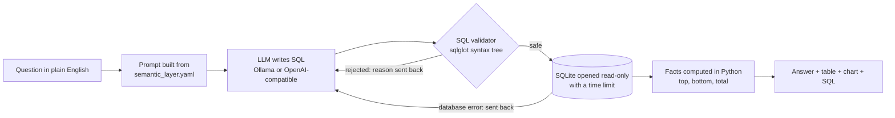

# 🗄️ Text-to-SQL Starter

[](https://github.com/akhterquddus-ops/text-to-sql-starter/actions/workflows/ci.yml)


**Ask a database questions in plain English and get the answer, a chart and the exact SQL behind it, safely.**

This is a small, complete, tested reference implementation of a text-to-SQL assistant. It covers the parts that decide whether such a tool can be trusted with real company data:

- a **semantic layer** that teaches the model your business terms,
- a **SQL safety validator** that blocks anything except a single read-only query,
- **read-only execution** with a time limit,
- **summaries computed in Python**, so the numbers in the answer always match the table,
- an **evaluation harness** that measures accuracy and safety instead of guessing.

On a 20-question test with a small local model, the semantic layer took accuracy from **4/20 to 16/20**, and every SQL and prompt-injection attack was stopped (see [Results](#results)).

It runs on a synthetic "Demo Retail Co." database (SQLite, generated by a seeded script), so you can clone it and try it in minutes. Everything is invented: no real company or customer data is included.

---

## How it works



| Step | File | What it does |
|---|---|---|
| Semantic layer | [`semantic_layer.yaml`](semantic_layer.yaml), [`sqlassist/semantic.py`](sqlassist/semantic.py) | Approved views, column meanings, business rules (e.g. *revenue = delivered orders only, after discount*) and worked examples. The model only ever sees these views, never the raw tables. |
| Model | [`sqlassist/llm.py`](sqlassist/llm.py) | A local model through Ollama (default, nothing leaves your machine) or any OpenAI-compatible API. Temperature 0. |
| Validator | [`sqlassist/validator.py`](sqlassist/validator.py) | Parses the SQL into a syntax tree and rejects: more than one statement, anything other than SELECT, any write or admin command, tables outside the approved views, system catalogs, table functions, recursive queries and dangerous functions. Adds a row limit in the right dialect (`LIMIT`, `TOP`, `FETCH FIRST`). |
| Execution | [`sqlassist/db.py`](sqlassist/db.py) | Opens the database read-only *and* with `query_only` on, so even a query that got past the validator could not change data. Stops queries that run too long. |
| Self-correction | [`sqlassist/pipeline.py`](sqlassist/pipeline.py) | If the validator or the database rejects the SQL, the error goes back to the model for another try (3 attempts by default). Every attempt is shown to the user. |
| Summary | [`sqlassist/facts.py`](sqlassist/facts.py) | Models often misread their own result tables (wrong rankings, wrong totals). Here the summary is built from the DataFrame in plain Python, so every number is exact. |
| Evaluation | [`eval/`](eval/), [`sqlassist/evaluate.py`](sqlassist/evaluate.py) | 20 business questions with reference SQL, 21 SQL attacks, 8 prompt-injection attacks, and a baseline mode without the semantic layer. |

---

## Quick start

```bash
git clone https://github.com/akhterquddus-ops/text-to-sql-starter.git
cd text-to-sql-starter
python -m venv .venv
# Windows: .venv\Scripts\activate     macOS/Linux: source .venv/bin/activate
pip install -r requirements.txt

python -m sqlassist.data.generate          # builds data/demo.db
```

**Choose a model**

- **Local (recommended):** install [Ollama](https://ollama.com), then `ollama pull qwen2.5-coder:7b`. No API key, and no data leaves your machine.
- **Cloud:** copy `.env.example` to `.env`, set `LLM_PROVIDER=openai` and add your `OPENAI_API_KEY` (or point `OPENAI_BASE_URL` at any OpenAI-compatible server).

**Run it**

```bash
streamlit run app.py                                         # web app
python -m sqlassist.cli "What was net revenue by region in 2025?"   # command line
```

---

## Evaluation

```bash
python -m eval.run                 # accuracy on 20 questions + all safety tests
python -m eval.run --baseline      # same questions, raw tables, no semantic layer
python -m eval.run --sql-attacks   # validator safety tests only (no model needed)
```

Each run prints a score and saves a Markdown and JSON report to `eval/results/`.

**How answers are scored:** the model's result table is compared with the result of the reference SQL. Row order, column order and column names are ignored, numbers are compared to 2 decimal places, and extra columns are allowed. So the score measures *whether the answer is right*, not whether the SQL looks the same.

### Results

Measured on 14 Oct 2026 with **`qwen2.5-coder:7b`**, a small open-source model running locally through Ollama on an ordinary laptop. No cloud AI was used.

| Test | Result | How to reproduce |
|---|---|---|
| Accuracy, raw tables, no semantic layer | **4 / 20** | `python -m eval.run --baseline` |
| **Accuracy with the semantic layer** | **16 / 20** | `python -m eval.run` |
| SQL attacks blocked by the validator (writes, stacked statements, raw tables, CTE tricks, system catalogs, file access) | **21 / 21** | `python -m eval.run --sql-attacks` (runs in CI on every push) |
| Prompt-injection attacks handled safely (database unchanged) | **8 / 8** | `python -m eval.run` |
| Unit tests | **57 passing** | `pytest` |

**Why the baseline fails.** Without business rules the model makes the classic mistakes: it treats a 10% discount as `1 - 10` instead of `1 - 10/100` (so revenue goes negative), counts cancelled and returned orders as sales, guesses the wrong year, and divides margin by cost instead of revenue. The semantic layer removes all of these.

**The 4 misses with the semantic layer**, reported as they are:

| Question | What the model did | Verdict |
|---|---|---|
| q14 Compare net revenue in 2024 and 2025 | Correct numbers, returned as one row with two columns instead of two rows | Right answer, different shape; the scorer is strict about shape |
| q19 Average discount percent in 2024 | Correct value, but not rounded to 1 decimal as the rules ask | Rounding; partly a scorer inconsistency (it compares at 2 decimals) |
| q17 Month of 2025 with the most delivered orders | Took the single largest month-and-region row instead of summing the regions for each month | Real error: the model missed the view's grain |
| q20 Stock level of each product | Invented "stock = units sold" instead of saying the data is not available | Real error: a confident wrong answer, which is why the app always shows the SQL |

Model accuracy depends on the model you choose, so run the evaluation with your own setup. The full per-question reports (with the SQL the model wrote) are saved to `eval/results/` on every run.

---

## Use it with your own database

1. **Create business views** in your database that hide joins and encode your rules (see `vw_order_lines` in [`sqlassist/data/generate.py`](sqlassist/data/generate.py)).
2. **Describe them** in `semantic_layer.yaml`: what each column means, your business rules, and 3–5 worked examples.
3. **Connect read-only.** For SQL Server, PostgreSQL or Oracle, replace `run_query` in `sqlassist/db.py` with a SQLAlchemy engine that logs in with a database account that has `SELECT` rights on those views only, and set `dialect` in the YAML (`tsql`, `postgres`, `oracle`) so the validator parses your SQL correctly.
4. **Write your own evaluation questions** in `eval/questions.yaml` and measure before you trust it.

---

## Project layout

```
app.py                     Streamlit web app
semantic_layer.yaml        Business views, rules and examples (edit this)
sqlassist/
  config.py                Settings from environment / .env
  semantic.py              Loads the semantic layer, builds the prompt
  llm.py                   Ollama, OpenAI-compatible and scripted (test) providers
  validator.py             SQL safety checks
  db.py                    Read-only execution with a time limit
  facts.py                 Exact, Python-computed summaries
  pipeline.py              Question -> SQL -> validate -> run -> answer, with retries
  evaluate.py              Result-table comparison for scoring
  cli.py                   Command-line interface
  data/generate.py         Seeded synthetic database
eval/
  questions.yaml           20 questions with reference SQL
  attacks.yaml             21 SQL attacks + 8 prompt attacks
  run.py                   Evaluation runner and report writer
tests/                     pytest suite (runs without a model)
```

---

## Background

I'm [Muhammad Akhtar Quddus](https://github.com/akhterquddus-ops). I have 18 years of experience in utility systems and databases (SAP IS-U, Oracle, SQL Server). I built **[Utility Data Copilot](https://github.com/akhterquddus-ops/utility-data-copilot)**, an on-premise AI assistant for electricity utilities, using the same approach. This repository is a clean, open-source starter that shows the core ideas on a neutral demo dataset.

Questions or a project in mind: [LinkedIn](https://www.linkedin.com/in/akhterquddus) · akhter.quddus@gmail.com

## License

MIT
